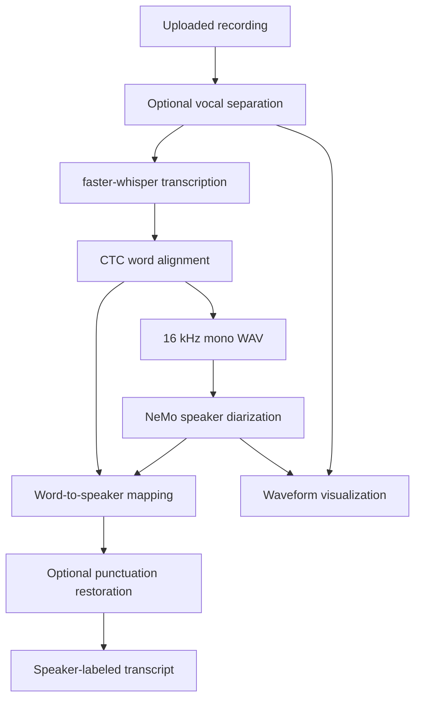

# voice-sphere

**A Streamlit prototype for speaker-labeled transcription and audio visualization.**

voice-sphere accepts an audio recording and combines vocal separation, speech recognition, word alignment, and speaker diarization. It displays the original waveform, a processed waveform colored by speaker, and a timestamped transcript with generic speaker labels.

The implementation lives in a single `app.py`. It requires a substantial local audio/ML environment and downloads model/configuration resources. The dependency inventory is not a tested compatibility lock, and the current diarization-output parser needs validation against the installed NeMo release before end-to-end results can be relied upon.

## Contents

- [Capabilities](#capabilities)
- [Processing pipeline](#processing-pipeline)
- [Setup](#setup)
- [Usage](#usage)
- [Configuration](#configuration)
- [Files and lifecycle](#files-and-lifecycle)
- [Code guide](#code-guide)
- [Validation](#validation)
- [Known limitations](#known-limitations)

## Capabilities

| Area | Included behavior |
| --- | --- |
| Audio input | Streamlit uploader for MP3, WAV, and OGG, with in-browser playback. |
| Vocal separation | Attempts Demucs `htdemucs` two-stem separation and falls back to the original file if the command fails. |
| Transcription | Uses faster-whisper with the `small` model by default. |
| Word timing | Uses CTC forced alignment to associate recognized words with timestamps. |
| Speaker diarization | Configures NeMo voice activity detection, speaker embeddings, clustering, and an MSDD diarizer. |
| Punctuation | Restores punctuation for a supported subset of detected languages. |
| Transcript | Groups words by speaker changes and displays speaker labels and time ranges. |
| Visualization | Plots original and processed waveforms, with speaker segments overlaid in different colors. |

Speaker labels such as `Speaker 0` are cluster identifiers within a recording. They do not identify a person. Diarization assigns time ranges; the application does not export a separate audio track for each speaker.

## Processing pipeline



The app loads the original recording with librosa, attempts vocal separation, and transcribes the selected audio. It then generates alignment emissions and word spans, writes a mono WAV for diarization, and reads speaker intervals from NeMo output. Word timestamps are matched to those intervals before punctuation and transcript formatting.

Sentence grouping in the active helper primarily follows speaker changes. The transcript writer adjusts segment boundaries to make successive displayed ranges continuous; these formatted boundaries should not be treated as independent alignment measurements.

## Setup

### Environment requirements

- A Python environment compatible with the selected NeMo, PyTorch, torchaudio, faster-whisper, and aligner versions.
- Matching PyTorch/torchaudio builds for your CPU or CUDA environment.
- FFmpeg available for audio decoding and separation tools.
- Network access for model downloads and the NeMo configuration file.
- Sufficient disk space and memory for multiple speech models and intermediate audio.

The repository does not establish a supported Python/OS/GPU matrix. CUDA is selected when `torch.cuda.is_available()` is true; otherwise the code selects CPU. That fallback is code behavior, not a guarantee that every dependency and operation works on every CPU installation.

### Install

```bash
git clone https://github.com/quixoticalcoder/voice-sphere.git
cd voice-sphere
python3 -m venv .venv
source .venv/bin/activate
```

On Windows, activate with `.venv\Scripts\activate`.

Install compatible `torch` and `torchaudio` builds for your hardware, then use the inventory:

```bash
pip install -r requirements.txt
```

[`requirements.txt`](requirements.txt) records the modules imported or invoked by the source. It is intentionally unpinned because the original working environment was not provided. In particular, the installed `ctc_forced_aligner` must export the functions imported at the top of `app.py`, and the NeMo version must support the referenced `NeuralDiarizer` API. Resolve and pin those versions together before treating this as a reproducible installation.

### Launch

```bash
python -m streamlit run app.py
```

Open the local URL printed by Streamlit, normally `http://localhost:8501`. Run from a writable working directory: uploads and intermediate files are written there. No application API key, account database, or separate frontend build is configured.

## Usage

1. Upload an MP3, WAV, or OGG recording.
2. Listen to the uploaded audio if needed.
3. Click **Process Audio**.
4. Review the original and processed waveforms.
5. Review the diarized transcript and its speaker/time labels.

All model settings are currently Python function defaults rather than sidebar controls. Processing is synchronous from the UI's perspective and may take substantial time, especially on CPU or during the first model download.

The transcript is displayed on the page. There is no download button in the current interface. Successful processing deletes the temporary transcript file after reading it for display.

## Configuration

`process_audio()` defines these defaults:

| Parameter | Default | Behavior |
| --- | --- | --- |
| `enable_stemming` | `True` | Attempts Demucs vocal separation. |
| `whisper_model_name` | `"small"` | faster-whisper model selection. |
| `suppress_numerals` | `True` | Suppresses tokens containing digits and selected currency/percentage symbols. |
| `batch_size` | `8` | Uses the batched transcription path; nonpositive values select the alternate path. |
| `language` | `None` | Passed to transcription for automatic language detection. |
| `device` | CUDA if available, else CPU | Selected when the function is defined. |

Whisper compute type is hardcoded to `int8`. The alignment model uses float16 on CUDA and float32 on CPU. The default alignment model comes from the installed aligner package rather than an explicit model identifier in this repository.

NeMo configuration uses:

- `vad_multilingual_marblenet` for voice activity detection.
- `titanet_large` for speaker embeddings.
- `diar_msdd_telephonic` for diarization.
- A telephonic inference YAML downloaded from the NeMo repository's `main` branch.

These names describe source configuration, not a verified current model catalog. Telephonic configuration may not suit meetings, music, overlapping speech, or noisy recordings equally well.

Punctuation uses `kredor/punctuate-all` for English, French, German, Spanish, Italian, Dutch, Portuguese, Bulgarian, Polish, Czech, Slovak, and Slovenian. Other detected languages skip that stage. The larger language tables do not establish end-to-end support or quality for every listed language.

## Files and lifecycle

```text
voice-sphere/
├── app.py                    Streamlit UI and processing helpers
├── requirements.txt          Dependency inventory
├── README.md
└── .gitignore
```

Runtime paths include:

| Path | Purpose |
| --- | --- |
| `uploaded_audio.<extension>` | Uploaded recording saved in the working directory. |
| `temp_outputs/htdemucs/.../vocals.wav` | Separated vocal audio. |
| `temp_outputs/mono_file.wav` | Audio passed to diarization. |
| `temp_outputs/data/input_manifest.json` | NeMo input manifest. |
| `temp_outputs/diar_infer_telephonic.yaml` | Downloaded diarization configuration. |
| `temp_outputs/pred_rttms/mono_file.rttm` | Expected diarization output. |
| `uploaded_audio.txt` | Temporary UTF-8 transcript. |

The successful UI path removes the temporary directory, uploaded input, and transcript. Failure paths do not consistently clean every intermediate file. Fixed filenames are shared across runs and sessions; this is not safe isolation for concurrent users. Generated files are excluded from Git by the cleanup's ignore rules.

## Code guide

| Function | Responsibility |
| --- | --- |
| `create_config` | Downloads and customizes NeMo configuration and writes its manifest. |
| `process_audio` | Coordinates separation, transcription, alignment, diarization, and transcript creation. |
| `get_words_speaker_mapping` | Assigns aligned words to speaker intervals using an anchor timestamp. |
| `get_realigned_ws_mapping_with_punctuation` | Adjusts speaker labels around punctuation-defined boundaries. |
| `get_sentences_speaker_mapping` | Groups words into speaker turns. |
| `get_speaker_aware_transcript` | Writes labeled text with optional timestamps. |
| `write_str` | SRT-format helper; not exposed in the current UI. |
| `cleanup` | Removes a file or directory tree passed to it. |

## Validation

A syntax check does not require downloading models:

```bash
python -m py_compile app.py
```

After constructing a compatible environment, check dependency consistency:

```bash
python -m pip check
```

The cleanup verified syntax and isolated transcript-formatting helpers. Full audio processing, model downloads, GPU execution, and output quality were not validated. The repository contains no maintained automated test suite or accuracy benchmark.

For end-to-end validation, use a short recording with known speaker turns, inspect the actual NeMo RTTM output, and compare word timings and labels against the recording. Test empty speech, unsupported audio, failed separation, and repeated sessions as well as a successful sample.

## Known limitations

- **RTTM parsing:** the code uses fixed positions 5, 8, and 11 after splitting a line on a single space. Output layout and whitespace differences can produce incorrect values or index errors. Validate this parser against actual NeMo output before relying on it.
- **Failure flow:** when `process_audio()` returns `None`, the UI reports failure but continues into code that indexes the result, causing a secondary exception.
- **Dependency reproducibility:** no original version lock is available, and configuration is downloaded from a moving branch. Model APIs and return structures may differ across releases.
- **Shared storage:** fixed input and temporary paths can collide across sessions; cleanup can remove another run's intermediates.
- **Resource use:** models are created per processing run without Streamlit resource caching. There is no application-level duration/resource budget or background job queue.
- **Input/rendering:** uploaded filenames and transcript text are interpolated into HTML marked unsafe. The app has no authentication or user storage boundary.
- **Transcription choices:** default numeral suppression may omit numbers that matter in a transcript. Empty text, alignment gaps, and overlapping speakers need additional handling.
- **Exports and persistence:** the UI does not retain a transcript history or offer downloadable speaker tracks/SRT files, despite having formatting helpers.

## Development priorities

Establish a compatible version lock and repair RTTM parsing first. Then add per-run temporary directories, reliable cleanup, failure short-circuiting, and tests using known audio fixtures. Expose model/language options deliberately, add transcript downloads, and measure diarization/transcription quality before making performance claims.

## Contributing and license

Use `voice-sphere` consistently in project-facing text. Keep library/model identifiers intact and describe the audio conditions used to verify a change.

No project-wide license file is included. Review code, model, and third-party dependency terms before reuse or redistribution.
